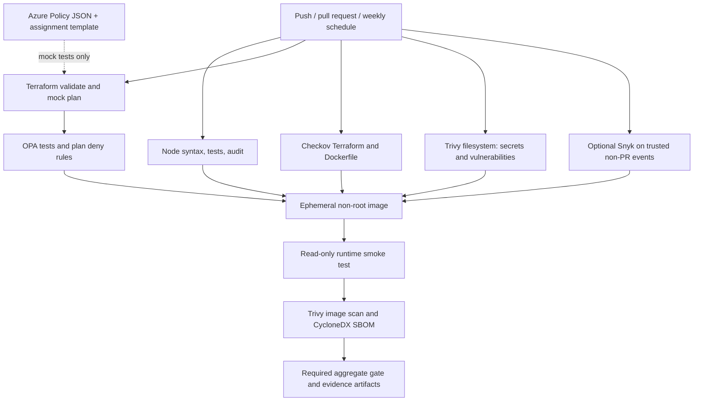

# Azure DevSecOps Policy Pipeline

[](https://github.com/DrOSAlchemist/azure-devsecops-policy-pipeline/actions/workflows/ci.yml)

**DrOSAlchemist | Platform engineering / policy-as-code / container security**

I built this project around one question: **what evidence should a delivery
pipeline produce before I trust an application image or infrastructure change?**

The result is a small application surrounded by a deliberately more substantial
engineering workflow: Terraform mock tests, OPA guardrails, Checkov configuration
checks, Trivy scans, a constrained container smoke test and an inspectable SBOM.
The interesting part is not the dashboard. It is how the checks connect, what
they reject, and how a failed scan leads to a verifiable fix.

[Portfolio](https://drosalchemist.net/) /
[Source and change history](https://github.com/DrOSAlchemist/azure-devsecops-policy-pipeline/commits/main) /
[Workflow runs](https://github.com/DrOSAlchemist/azure-devsecops-policy-pipeline/actions/workflows/ci.yml) /
[Code walkthrough](docs/engineering.md)

## At a glance

| Area | Implementation |
| --- | --- |
| Application | Dependency-free Node.js HTTP server; static dashboard and two JSON endpoints |
| Infrastructure | Five AzureRM resources, provider lockfile and six mock-plan assertions |
| Policy | Rego v1 allow/deny rules; 12 positive and negative policy tests |
| Delivery checks | GitHub Actions, Checkov, Trivy, npm audit and optional Snyk |
| Runtime | Digest-pinned Node image, non-root user, read-only smoke test, no bundled package managers |
| Evidence | Test output, generated mock plan, scan reports and CycloneDX SBOM |
| Scope | Source, policy and image validation; no Azure account or deployment required |

### Read this project in five minutes

1. [Design decisions](#design-decisions): why these tools and boundaries.
2. [Pipeline architecture](#architecture): how a change reaches the final gate.
3. [Code map](#repository-map): where the implementation lives.
4. [A real finding and fix](#a-real-finding-and-fix): what the image scanner caught.
5. [Run it locally](#run-the-application-locally): reproduce the application checks.

## The engineering problem

A syntax check can pass while a container ships unnecessary vulnerable tooling.
A Terraform configuration can validate while declaring insecure transport.
A policy test can pass against a hand-written fixture while the real generated
plan is never evaluated. And a skipped scanner can disappear behind an otherwise
green workflow.

I separated those concerns instead of treating "security scanning" as one step:

- **Behavior:** exercise the HTTP contract, error paths and evidence extractor.
- **Configuration:** validate the provider schema and scan declared settings.
- **Intent:** evaluate project-specific policy against a generated mock plan.
- **Artifact:** start and inspect the actual image, then scan its final filesystem.
- **Acceptance:** aggregate the results and distinguish required passes from
  deliberately disabled integrations.

This is a source-to-validation pipeline, not an implemented production CD system.
Azure Policy definitions and assignments are included as code; live cloud
enforcement is outside the project's current scope.

## Design decisions

| Decision | Why I chose it | Trade-off |
| --- | --- | --- |
| Native Node HTTP, no framework | Keeps application behavior and the runtime dependency surface easy to inspect. | Routing, headers and lifecycle handling are explicit rather than framework-provided. |
| Terraform mock providers | Exercises the AzureRM schema and produces plan-shaped policy input without credentials. | Does not establish resource availability, permissions or live enforcement. |
| OPA alongside Checkov | Checkov covers a broad configuration baseline; OPA expresses this topology's exact rules. | The two rule sets need maintenance; neither replaces runtime testing. |
| Scan after building | Repository scans cannot see everything inherited from the base image. | Image inspection adds CI time and depends on current advisory data. |
| Remove unused npm/Yarn | The server runs directly with Node and needs no package manager in its runtime. | Runtime package installation is intentionally unavailable. |
| Explicit aggregate gate | Prevents an unexpectedly skipped mandatory job from looking acceptable. | Branch protection must separately require that status check. |
| Snyk opt-in | Keeps the default path reproducible without an external token or entitlement. | Snyk coverage is unavailable until it is configured and actually run. |

The implementation favors visible failure over green-looking fallback behavior.
Scanner setup errors fail their jobs; policy checks do not treat absent required
values as secure defaults. Exceptions remain scoped to individual resources.

## Architecture



The application is deliberately small: a static engineering dashboard, `/healthz`
and a read-only `/api/controls` inventory. There are no production dependencies,
login flows, persistent user data or external service calls.
The runtime image removes bundled npm/Yarn: they are not needed to execute this
server. CI checks their absence before performing the independent image scan.

### What happens on a change

The application, infrastructure, Checkov and filesystem jobs run independently.
The infrastructure job extracts the single plan emitted by `terraform test`,
then evaluates **that generated plan** with OPA after the Rego tests pass.
The image job waits for the upstream gates, including Snyk when enabled for the
event. It builds locally on the runner with `push: false`, starts the container
with a read-only filesystem and dropped capabilities, checks non-root execution
and package-manager removal, then scans the image and generates its SBOM.

The `required` job runs even when a dependency fails. It accepts only successful
mandatory jobs and the expected Snyk state. It does not deploy or publish an image.

## Repository map

| Path | Responsibility |
| --- | --- |
| [`src/server.js`](src/server.js) | Server factory, exact route allowlist, response headers, port validation and shutdown |
| [`src/controls.js`](src/controls.js) | Read-only control inventory and per-tool coverage boundaries |
| [`public/`](public/) | DrOSAlchemist project page and responsive stylesheet; no client-side JavaScript |
| [`tests/`](tests/) | HTTP regressions and extraction failure/overwrite tests |
| [`infra/`](infra/) | Azure App Service topology, inputs, output and provider lock |
| [`infra/tests/security.tftest.hcl`](infra/tests/security.tftest.hcl) | Mock provider IDs and six assertions in one plan run |
| [`infra/policies/require-https.json`](infra/policies/require-https.json) | Azure Policy rule denying top-level web apps without HTTPS-only transport |
| [`policy/`](policy/) | Rego guardrails and mutated-plan negative cases |
| [`scripts/`](scripts/) | Checksum-verified OPA installer and strict test-event plan extractor |
| [`Dockerfile`](Dockerfile) / [`.dockerignore`](.dockerignore) | Pinned runtime, unused-tool removal and allowlisted image context |
| [`.github/workflows/ci.yml`](.github/workflows/ci.yml) | Job graph, scanner exit codes, runtime checks and evidence retention |
| [`.github/dependabot.yml`](.github/dependabot.yml) | Reviewable dependency-update proposals; no automatic merging |
| [`docs/engineering.md`](docs/engineering.md) | Request flow, policy mechanics, file-level explanations and extension points |

## A real finding and fix

The first image scan found **four high-severity advisories** in npm dependencies
inherited from the Node base image: `brace-expansion`, `http-cache-semantics`
and `undici`. The application itself had no installed npm dependencies, so a
clean application audit alone would have missed that runtime packaging issue.

I removed the unused npm tree and Yarn installation from the image, added a
runtime assertion for their absence, and kept the Trivy threshold unchanged.
The subsequent image scan passed with **zero high/critical findings**.
That is a result for that image and advisory database, not a permanent
vulnerability-free claim.

| Baseline evidence, 2026-10-18 | Result |
| --- | --- |
| [Before remediation](https://github.com/DrOSAlchemist/azure-devsecops-policy-pipeline/actions/runs/39171500931) | Container smoke test passed; image scan blocked acceptance |
| [After remediation](https://github.com/DrOSAlchemist/azure-devsecops-policy-pipeline/actions/runs/39171713521) | All mandatory jobs passed; Snyk explicitly skipped |
| Application/tooling suite | 11 tests passed; coverage is reported, not enforced as a threshold |
| OPA suite | 12 tests passed, including insecure and missing-value cases |
| Terraform | One mock plan run passed six assertions |
| Final image artifact | Trivy high/critical scan passed; CycloneDX SBOM generated |

The [remediation notes](docs/operations.md#initial-image-finding-and-mitigation)
record the advisory IDs and why removal was appropriate. Artifacts have a
seven-day retention window; the linked job logs and commit history explain the
sequence even after downloads expire. Use the badge and latest workflow run for
current status rather than assuming the baseline result still applies.

## Run the application locally

Requires Node.js 24 or newer. No Azure account or npm credentials are needed.

```sh
npm ci --ignore-scripts
npm run check
npm test
npm run audit
npm start
# Open http://localhost:8080
```

There is no transpilation or application build step. Node executes the checked-in
ES modules directly. The Docker build belongs to the CI image-validation stage,
not to local application setup.

### HTTP contract

| Method | Path | Response |
| --- | --- | --- |
| GET / HEAD | `/` | Project page; HEAD returns headers without a body |
| GET / HEAD | `/style.css` | External stylesheet compatible with the content security policy |
| GET / HEAD | `/healthz` | `200`, `{"status":"ok"}` for GET |
| GET / HEAD | `/api/controls` | `200`, static inventory with `mode`, `cloudDeployed: false` and six controls |
| GET / HEAD | Any other path | `404`, JSON error |
| Any other method | Any path | `405`, `Allow: GET, HEAD` |

The inventory is **declared coverage**, not a live scanner-status API.
It does not read GitHub tokens, invoke scanners or claim that a job has passed.
Static asset read failures return `500` and log the filesystem error code.

Set `PORT` to an integer from 1 through 65535 if needed. The server rejects
unsupported methods and paths, uses security headers, bounds header/request
timeouts and logs asset/server failures without exposing internal errors.
TLS termination and authenticated access are deployment responsibilities; this
local HTTP demo does not pretend to implement either.

## Reproduce infrastructure and policy checks

Requires Terraform 1.16.x. CI pins 1.16.6; the AzureRM provider is locked to
5.10.0. Downloads require network access but these checks require **no Azure
subscription, login or cloud API access**.

```sh
terraform fmt -check -recursive infra
terraform -chdir=infra init -backend=false -input=false -lockfile=readonly
terraform -chdir=infra validate
mkdir -p reports
terraform -chdir=infra test -verbose -json > reports/terraform-test.jsonl &&
# The extractor refuses an existing output so it cannot reuse stale evidence.
node scripts/extract-plan.js reports/terraform-test.jsonl reports/plan.json
bash scripts/install-opa.sh
.tools/opa test policy -v
.tools/opa eval --fail --data policy/terraform.rego \
  --input reports/plan.json 'data.terraform.guardrails.allow == true'
```

Before repeating extraction, explicitly remove only the old generated
`reports/plan.json`. The OPA installer supports Linux x86_64 and macOS ARM64,
pins the release and checks its official SHA-256 sidecar.

OPA rejects empty/malformed plans, missing resource types, unknown required
security values, unsupported managed resource types, deletions, missing tags,
insecure transport, basic publishing authentication, mutable images, weakened
policy definitions and disabled policy enforcement. Rules are intentionally
specific to this reference topology, **not a general Azure compliance engine**.
Mock plans cannot verify Azure RBAC, actual alias enforcement, policy propagation,
regional capacity, production readiness or an actual application deployment.

### Important Terraform boundary

| Input | Default | Intent |
| --- | --- | --- |
| `project_name` | `devsecops-reference-demo` | Validated naming example; uniqueness is not verified |
| `location` | `eastus2` | Illustrative region, not a capacity or price recommendation |
| `owner` | `platform-engineering` | Required nonblank ownership tag |
| `container_image` | Digest-pinned Node 24 Alpine base | Schema/policy example, not the built dashboard image |

The container-image input deliberately defaults to the **base Node image** solely
to demonstrate a digest-pinned schema. It is **not the built application image**,
does not contain this server and would not serve this application. Before any
future real deployment, a separately approved design must provide a published,
scanned application image, real identity/backend configuration, a unique name,
cost/capacity checks, runtime validation and a production security review.

The example premium plan has two workers and zone balancing enabled. It would
incur cloud charges if independently applied. **Do not run `terraform apply` as a
demo step.** This repository intentionally contains no apply or deployment job.
The custom definition is subscription-scoped if ever created; its assignment
scope is only the demonstration resource group. It covers top-level web apps,
not slots or unrelated resource types.

## CI gates and evidence

| Job | Enforcement | Evidence |
| --- | --- | --- |
| Application | Syntax, HTTP tests, npm high/critical audit | Test and coverage output in logs |
| Infrastructure | Formatting, provider validation, mock assertions, OPA tests and generated-plan evaluation | Mock JSONL and extracted plan artifact |
| Checkov | All discovered Terraform/Dockerfile checks except four documented per-resource exceptions | JUnit report and logs |
| Filesystem | Trivy high/critical vulnerabilities and detected secrets | JSON artifact |
| Snyk | Optional; when enabled on non-PR events, failures block the final gate | Dependency and IaC JSON artifacts |
| Image | Non-root/read-only smoke test, Trivy high/critical vulnerabilities | Scan JSON and CycloneDX SBOM |
| Required | Rejects failed, cancelled or unexpectedly skipped mandatory jobs | Explicit optional-scanner status in logs |

Reports expire after **7 days**. Scanner database/network/auth failures are real
failures, not successful empty results. Vulnerabilities without fixes still fail
the Trivy gate; there is no `ignore-unfixed` shortcut. Review the actual run and
artifacts rather than treating this README as proof of a current pass.

### Enable optional Snyk

1. Add a repository Actions secret named `SNYK_TOKEN`.
2. Set the repository Actions variable `SNYK_ENABLED` to `true`.
3. Run the workflow manually or push to `main`.

Without both configuration and credentials, no Snyk pass is claimed. Enabling
the variable without the token fails the job. Pull requests never receive this
token or run Snyk; after merge it runs on trusted `main`. The CLI is pinned, while
the underlying service/advisory database changes independently. A dependency-free
project may produce no dependency findings; the IaC scan remains a separate
check and neither result is a comprehensive application security assessment.

## Maintainer operations

See [security exceptions](docs/security-exceptions.md),
[remediation and maintenance](docs/operations.md), [contribution guidance](CONTRIBUTING.md)
and the [security reporting policy](SECURITY.md).

Set the **`required`** job as a required status check in GitHub branch protection
or a repository ruleset. The workflow itself does not configure repository
administration. Without that setting, CI does not prevent a maintainer from
merging a failing branch. No cloud credentials, paid services or deployment
permissions are required for the default workflow.

## References

- [Terraform mocked providers](https://developer.hashicorp.com/terraform/language/tests/mocking)
- [AzureRM Linux web app resource](https://registry.terraform.io/providers/hashicorp/azurerm/5.10.0/docs/resources/linux_web_app)
- [Azure Policy definition structure](https://learn.microsoft.com/azure/governance/policy/concepts/definition-structure-policy-rule)
- [OPA Terraform tutorial](https://www.openpolicyagent.org/docs/terraform)
- [Checkov](https://www.checkov.io/)
- [Trivy](https://trivy.dev/)
- [Snyk CLI](https://docs.snyk.io/snyk-cli)
