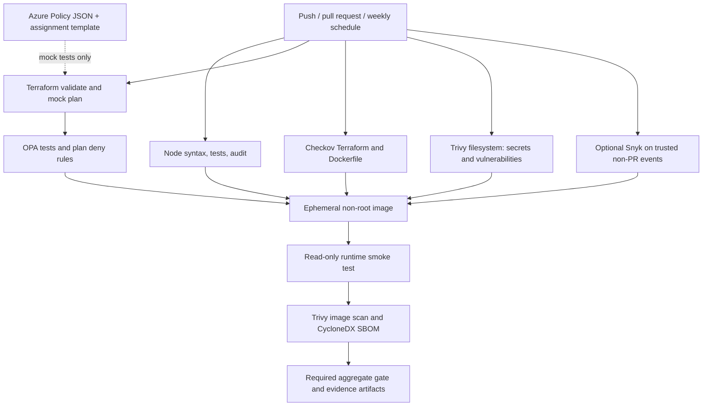

# Azure DevSecOps Policy Pipeline

[](https://github.com/DrOSAlchemist/azure-devsecops-policy-pipeline/actions/workflows/ci.yml)

A **code-only, subscription-free reference implementation** of application tests,
policy-as-code and automated security scanning. Nothing here signs into Azure,
creates resources, publishes container images, deploys applications or changes a
website. GitHub Actions builds an ephemeral image **only to test and scan it**.

## Implementation summary

Implemented a layered DevSecOps reference pipeline combining **Checkov**, **OPA**
and **Trivy**, with an explicitly optional **Snyk** integration. The pipeline
checks application behavior, validates Azure Terraform templates with mocked
providers, enforces tested plan guardrails, and scans filesystem and container
artifacts. An Azure Policy deny definition and resource-group assignment are
included as undeployed governance templates.

Pinned action revisions, provider locking, scoped scanner exceptions, retained
reports and scheduled scans make changes inspectable. Dependabot proposes
dependency updates; maintainers review and remediate findings. There is **no
automatic remediation, cloud compliance certification, proven production-scale
claim or live Azure enforcement**.

Snyk is a commercial developer-security platform with a CLI, not a claim that this
entire framework is open-source-only. Credentials and product entitlements may
be required. A skipped Snyk job means **not run**, not "no vulnerabilities."

## Architecture



The application is deliberately small: a static engineering dashboard, `/healthz`
and a read-only `/api/controls` inventory. There are no production dependencies,
login flows, persistent user data or external service calls.

## Run the application locally

Requires Node.js 24 or newer. No Azure account or npm credentials are needed.

```sh
npm ci --ignore-scripts
npm run check
npm test
npm run audit
npm start
# Open http://localhost:8080
```

Set `PORT` to an integer from 1 through 65535 if needed. The server rejects
unsupported methods and paths, uses security headers, bounds header/request
timeouts and logs asset/server failures without exposing internal errors.
TLS termination and authenticated access are deployment responsibilities; this
local HTTP demo does not pretend to implement either.

## Reproduce infrastructure and policy checks

Requires Terraform 1.16.x. CI pins 1.16.6; the AzureRM provider is locked to
5.10.0. Downloads require network access but these checks require **no Azure
subscription, login or cloud API access**.

```sh
terraform fmt -check -recursive infra
terraform -chdir=infra init -backend=false -input=false -lockfile=readonly
terraform -chdir=infra validate
mkdir -p reports
terraform -chdir=infra test -verbose -json > reports/terraform-test.jsonl
# The extractor refuses an existing output so it cannot reuse stale evidence.
node scripts/extract-plan.js reports/terraform-test.jsonl reports/plan.json
bash scripts/install-opa.sh
.tools/opa test policy -v
.tools/opa eval --fail --data policy/terraform.rego \
  --input reports/plan.json 'data.terraform.guardrails.allow == true'
```

Before repeating extraction, explicitly remove only the old generated
`reports/plan.json`. The OPA installer supports Linux x86_64 and macOS ARM64,
pins the release and checks its official SHA-256 sidecar.

OPA rejects empty/malformed plans, missing resource types, unknown required
security values, unsupported managed resource types, deletions, missing tags,
insecure transport, basic publishing authentication, mutable images, weakened
policy definitions and disabled policy enforcement. Rules are intentionally
specific to this reference topology, **not a general Azure compliance engine**.
Mock plans cannot verify Azure RBAC, actual alias enforcement, policy propagation,
regional capacity, production readiness or an actual application deployment.

### Important Terraform boundary

The container-image input deliberately defaults to the **base Node image** solely
to demonstrate a digest-pinned schema. It is **not the built application image**,
does not contain this server and would not serve this application. Before any
future real deployment, a separately approved design must provide a published,
scanned application image, real identity/backend configuration, a unique name,
cost/capacity checks, runtime validation and a production security review.

The example premium plan has two workers and zone balancing enabled. It would
incur cloud charges if independently applied. **Do not run `terraform apply` as a
demo step.** This repository intentionally contains no apply or deployment job.
The custom definition is subscription-scoped if ever created; its assignment
scope is only the demonstration resource group. It covers top-level web apps,
not slots or unrelated resource types.

## CI gates and evidence

| Job | Enforcement | Evidence |
| --- | --- | --- |
| Application | Syntax, HTTP tests, npm high/critical audit | Test and coverage output in logs |
| Infrastructure | Formatting, provider validation, mock assertions, OPA tests and generated-plan evaluation | Mock JSONL and extracted plan artifact |
| Checkov | All discovered Terraform/Dockerfile checks except four documented per-resource exceptions | JUnit report and logs |
| Filesystem | Trivy high/critical vulnerabilities and detected secrets | JSON artifact |
| Snyk | Optional; when enabled on non-PR events, failures block the final gate | Dependency and IaC JSON artifacts |
| Image | Non-root/read-only smoke test, Trivy high/critical vulnerabilities | Scan JSON and CycloneDX SBOM |
| Required | Rejects failed, cancelled or unexpectedly skipped mandatory jobs | Explicit optional-scanner status in logs |

Reports expire after **7 days**. Scanner database/network/auth failures are real
failures, not successful empty results. Vulnerabilities without fixes still fail
the Trivy gate; there is no `ignore-unfixed` shortcut. Review the actual run and
artifacts rather than treating this README as proof of a current pass.

### Enable optional Snyk

1. Add a repository Actions secret named `SNYK_TOKEN`.
2. Set the repository Actions variable `SNYK_ENABLED` to `true`.
3. Run the workflow manually or push to `main`.

Without both configuration and credentials, no Snyk pass is claimed. Enabling
the variable without the token fails the job. Pull requests never receive this
token or run Snyk; after merge it runs on trusted `main`. The CLI is pinned, while
the underlying service/advisory database changes independently. A dependency-free
project may produce no dependency findings; the IaC scan remains a separate
check and neither result is a comprehensive application security assessment.

## Maintainer operations

See [security exceptions](docs/security-exceptions.md),
[remediation and maintenance](docs/operations.md), [contribution guidance](CONTRIBUTING.md)
and the [security reporting policy](SECURITY.md).

Set the **`required`** job as a required status check in GitHub branch protection
or a repository ruleset. The workflow itself does not configure repository
administration. Without that setting, CI does not prevent a maintainer from
merging a failing branch. No cloud credentials, paid services or deployment
permissions are required for the default workflow.

## References

- [Terraform mocked providers](https://developer.hashicorp.com/terraform/language/tests/mocking)
- [AzureRM Linux web app resource](https://registry.terraform.io/providers/hashicorp/azurerm/5.10.0/docs/resources/linux_web_app)
- [Azure Policy definition structure](https://learn.microsoft.com/azure/governance/policy/concepts/definition-structure-policy-rule)
- [OPA Terraform tutorial](https://www.openpolicyagent.org/docs/terraform)
- [Checkov](https://www.checkov.io/)
- [Trivy](https://trivy.dev/)
- [Snyk CLI](https://docs.snyk.io/snyk-cli)
